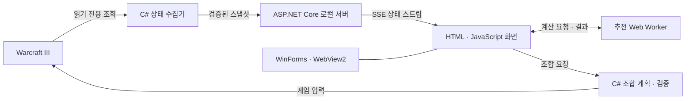

# 원랜디 도우미

원피스 랜덤 디펜스의 보유 유닛과 자원을 실시간으로 확인하고, 조합과 덱 구성을 돕는 Windows용 도우미다. 악몽 난이도 클리어 기록을 바탕으로 현재 보유 재료에 맞는 목표 덱과 제작 순서를 추천한다.

게임 상태 수집과 입력은 C#이 담당하고, 조합 그래프와 덱 추천은 JavaScript에서 계산한다. 화면은 WinForms·WebView2 안에서 실행한다.

## 주요 기능

| 기능 | 내용 |
| --- | --- |
| 보유 상태 연동 | 유닛 수량·자원·아이템과 판독 가능한 게임 조건을 화면에 반영한다. |
| 조합 정보 | 등급·역할별 유닛 목록에서 재료 진행률을 확인하고, 상세에서 부족한 재료·최하위 재료·상위 조합을 탐색한다. |
| 연속 조합 | 이미 보유한 중간 재료를 우선 사용하고, 필요한 하위 유닛부터 목표 유닛까지 제작한다. |
| 선택 위습 활용 | 부족한 흔함 재료의 필요량을 계산하고 선택 위습 준비와 조합을 연결한다. |
| 악몽 목표 덱 | 클리어 기록과 현재 패를 비교해 물리·마법·하이브리드 방향의 목표와 제작 순서를 제안한다. |
| 보조 유닛 추천 | 주력을 유지하면서 스턴·방어 감소 등 부족한 역할을 보완할 후보를 현재 재료에서 찾는다. |
| 조건별 추천 | 패왕의길·계엄령·신비함 선택과 유닛 제한·아이템 등 조합 조건을 반영한다. |
| 판 기록 | 라운드별 보유 구성 변화와 종료 상태를 기록한다. |

## 대표 사용 흐름

1. 지원 게임과 맵을 실행하면 보유 유닛·재료 상태가 도우미에 반영된다.
2. 유닛별 진행률과 상세 재료를 확인하거나 추천 목표 덱을 선택한다.
3. 조합 가능한 유닛을 누르면 하위 재료 준비부터 결과 생성 확인까지 이어서 처리한다.
4. 보유 유닛·보상·아이템·게임 조건이 바뀌면 제작 가능성과 추천을 다시 평가한다.

## 동작 구조



수집한 스냅샷은 SSE로 화면에 전달한다. 화면에서 계산한 조합 계획은 C# 서버가 현재 게임 상태로 다시 검증하고, 게임 입력 후 실제 재료 감소와 결과 유닛 증가를 확인해 다음 단계로 진행한다.

## 핵심 구현

### 세션과 내 재고를 분리한 상태 검증

게임 메모리를 두 번 읽고 같은 세션·플레이어의 재고가 일치하는지 확인한다. 적 생성으로 변하는 전체 유닛 배열과 내 보유 유닛의 변화를 분리해 조합 가능 상태를 안정적으로 판정한다.

맵 버전·소유자·재고를 확인할 수 없거나 상태가 오래됐으면 해당 정보를 조합 실행 허가로 사용하지 않는다.

### 공유 재료를 한 번만 사용하는 제작 계획

조합식을 그래프로 구성하고 여러 목표가 공유하는 재료를 하나의 재고 장부에서 계산한다. 직접 보유한 중간 유닛을 먼저 예약하며, 한 가지 조합 경로가 다른 목표의 재료나 보호된 유닛을 먼저 소비하지 않도록 확인한다.

진행률은 현재 재료와 선택 위습 활용 가능성을 구분하고, 목재·금화·아이템과 판독 가능한 특수 조건을 반영한다. 실제 조합 가능 여부는 별도의 조건 검증으로 판정한다.

### 계획 재검증과 결과 확인을 거치는 연속 조합

클라이언트가 보낸 제작 순서를 서버에서 현재 재고·자원·아이템·게임 조건으로 재생 검증한다. 같은 요청의 중복 실행과 요청 내용 변경을 구분하고, 매 단계 최신 상태로 남은 계획을 다시 확인한다.

조합 후 실제 재료 소비와 결과 생성을 대조해 완료를 판정한다. 일부 단계만 성공했거나 세션이 바뀐 경우에는 확인된 실행 결과를 기준으로 다음 동작을 결정한다.

### 현재 제작과 미래 완성 가능성을 나눈 추천

클리어 기록을 후보의 출발점으로 삼고, 현재 보유한 중간 재료의 활용도와 역할 구성을 비교한다. 물리·마법 시너지, 스턴·이동속도 감소, 마나·체력 보조와 조합 조건을 함께 검토한다.

현재 라운드와 남은 보상·랜덤 위습 확률은 목표의 완성 가능성을 평가하는 데 사용한다. 조합 실행은 현재 보유량과 조건을 만족한 제작 경로에 한해 허용한다.

추천 계산은 Web Worker로 분리한다. 동일한 입력에는 결과를 재사용하고, 재고·아이템·조건 등의 변화가 확인되면 다시 계산한다. 조합 중에는 목표 변경을 유예한다.

## 기술 구성

| 영역 | 기술과 역할 |
| --- | --- |
| 수집·조합 | C# / .NET 10, Windows 프로세스·입력 API |
| 로컬 서버 | ASP.NET Core / HTTP / SSE, 상태 전달과 조합 요청 처리 |
| 데스크톱 | WinForms / WebView2 |
| 화면·계산 | HTML / CSS / JavaScript, Web Worker |
| 검사 | .NET 프로젝트 빌드, Node.js 합성 회귀검사, PowerShell 검사 스크립트 |

## 소스 탐색

| 파일 | 역할 |
| --- | --- |
| [Program.cs](source/ord-unit-probe/Program.cs) · [SnapshotStability.cs](source/ord-unit-probe/SnapshotStability.cs) | 게임 상태 수집과 세션·재고 안정성 판정 |
| [LiveCounterServer.cs](source/ord-unit-probe/LiveCounterServer.cs) | 로컬 HTTP 서버와 상태 전달 |
| [CraftPlanner.cs](source/ord-unit-probe/CraftPlanner.cs) · [GameCraftService.cs](source/ord-unit-probe/GameCraftService.cs) | 재료 계획, 요청 검증과 연속 조합 처리 |
| [recipe-graph.js](source/ord-unit-probe/wwwroot/recipe-graph.js) | 조합 그래프·진행률·공동 제작 계획 |
| [nightmare-strategy.js](source/ord-unit-probe/wwwroot/nightmare-strategy.js) | 현재 패와 클리어 기록을 반영한 목표 덱 평가 |
| [nightmare-reinforcements.js](source/ord-unit-probe/wwwroot/nightmare-reinforcements.js) | 부족한 보조 역할의 제작 후보 탐색 |
| [desktop-host](source/ord-unit-probe/desktop-host) | WebView2 창과 프로그램 시작 처리 |

## 개발 환경

- Windows 및 .NET 10 SDK
- WebView2 Runtime
- 소스 검사에 사용할 PowerShell과 Node.js

현재 게임 연동 기준은 Warcraft III `1.28.5.7680`, 원랜디 `2.323[C]`다.

## 빌드

저장소 루트에서 실행한다.

```powershell
dotnet build .\source\ord-unit-probe\OrdUnitProbe.csproj -c Release
dotnet build .\source\ord-unit-probe\desktop-host\OrdHelperDesktop.csproj -c Release
```

## 소스 검사

```powershell
pwsh -File .\tools\Test-Source.ps1
```

검사 스크립트는 두 C# 프로젝트 빌드, JavaScript·HTML 스크립트 문법 검사, 합성 입력 기반 추천 회귀검사를 실행한다.

게임 연동 실행에는 저장소에 포함되지 않은 호환 게임 데이터와 유닛 아이콘이 별도로 필요하다.
